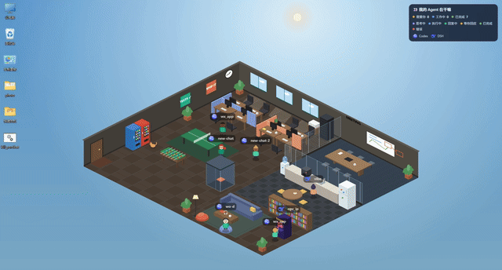

# whatsmyagentdoing

把正在工作的 AI Agent 放进一间实时更新的小办公室。你可以在浏览器里查看谁在思考、谁在执行工具、谁在等你回复，也可以用这个 fork 把办公室设成 Windows 动态壁纸。

本仓库 fork 自 [Charonyuu/whatsmyagentdoing](https://github.com/Charonyuu/whatsmyagentdoing)。原项目提供 `/myoffice` 技能、浏览器看板、2D／3D 办公室和多客户端会话追踪。[原作者网站](https://charonyuu.github.io/whatsmyagentdoing/) · [上游英文 README](https://github.com/Charonyuu/whatsmyagentdoing#readme)

## Windows 动态壁纸实拍



## 上游项目演示


| 2D 办公室 | 列表视图 |
| --- | --- |
|  |  |

<sub>以上为上游使用 `--demo` 录制的演示，展示的是模拟会话。</sub>

## 本 fork 的 Windows 壁纸功能

- **桌面实时显示**。通过 Lively Wallpaper 把办公室放在桌面图标后面，Node.js 在后台更新会话状态。
- **太阳升落和昼夜光照**。按电脑本地时间模拟约 06:00 日出和 18:00 日落，天空颜色、太阳位置和 2D 办公室的色温随时间变化。
- **光照预览**。用时间滑块预览一天中的任意时刻，随时切回当前时间。
- **桌面布局**。标题、会话计数、状态颜色和 Agent 图标集中到右上角浮层。2D 场景为上方的太阳轨迹和底部的任务栏留出空间。
- **隐私和静音**。`--wallpaper` 自动启用隐私模式，隐藏会话标题、提示词和回复；壁纸页面关闭声音和通知。

## 下载和运行

下面每一步都可以自己操作，也可以复制对应的「发给 AI」指令。豆包可以帮你逐步看命令输出和截图。如果你的 WorkBuddy 或其他 Agent 已连接这台电脑的终端或桌面，也可以请它执行已授权的本机操作。遇到系统安装提示时，按电脑上的提示操作即可。

### 第一步：检查 Git 和 Node.js

安装 Git 和 **Node.js 18 或以上**。安装后重新打开 PowerShell，运行 `git --version` 和 `node --version`。运行仓库中自带的看板无需安装 npm 依赖。要读取 OpenCode 和 Hermes 的 SQLite 会话，需要 **Node.js 22.13 或以上**。

> **发给 AI**
>
> 我用 Windows，第一次装开发工具。请帮我用 PowerShell 检查 `git --version` 和 `node --version`。如果缺工具，请告诉我去哪里安装，装好后怎么重新检查。能操作我的电脑就帮我检查，只能聊天就一步步教我，并告诉我该把哪条输出发给你。

### 第二步：下载 fork 并试运行

在你想存放项目的文件夹里打开 PowerShell，运行下面的命令。

```powershell
git clone https://github.com/codegowin-gqj/whatsmyagentdoing.git
cd whatsmyagentdoing
node bin/cli.js --demo
```

浏览器会打开演示办公室，默认地址为 `http://localhost:4545`。按 **Ctrl+C** 结束演示，运行 `node bin/cli.js` 就能查看本机会话。

> **发给 AI**
>
> 请帮我在 Windows 上从 https://github.com/codegowin-gqj/whatsmyagentdoing.git 下载项目，进入仓库目录，运行 `node bin/cli.js --demo`，再用终端打印的网址打开演示办公室。如果已经下载过，请先确认现有目录，别重复克隆。看到办公室后，告诉我怎么按 Ctrl+C 停止演示。不能操作电脑的话，请一次给我一条命令，等我贴结果再继续。

## 设置 Windows 动态壁纸

### 第三步：安装 Lively Wallpaper

从 [Lively Wallpaper 官方发行页](https://github.com/lively-community/lively/releases/latest) 下载 Windows 安装包，按提示安装。完成后，从开始菜单打开 **Lively Wallpaper**。

> **发给 AI**
>
> 请帮我确认这台 Windows 电脑有没有安装 Lively Wallpaper。如果没有，请带我从它的官方发行页 https://github.com/lively-community/lively/releases/latest 下载 Windows 安装器，并在安装后打开它。如果你只能聊天，请告诉我在发行页和安装窗口里该点哪里。

### 第四步：启动服务并添加壁纸
1. 在仓库目录打开 PowerShell，启动壁纸服务。想先看模拟小人，可以在命令末尾加 `--demo`。

   ```powershell
   node bin/cli.js --wallpaper --port 4546
   ```

2. 在 Lively 中点右上角 **＋**，选择「输入网址」，粘贴终端打印的壁纸地址。使用上面的命令时，地址如下。

   ```text
   http://localhost:4546/?wallpaper=1
   ```

3. 点击网址旁的箭头。看到办公室预览后，可以把标题改成「Agent 办公室」，再点「确定」。若壁纸没有立即应用，从「我的库」选中它即可。

浏览器可以关掉，保持 Node.js 服务和 Lively 运行。按 **Ctrl+C** 可停止终端里的服务。下次使用同一端口启动，Lively 就能继续使用已保存的地址。桌面壁纸默认用 2D 办公室，也可以在启动命令加上 `--scene office` 并使用终端打印的新地址来加载 3D 办公室。

> **发给 AI**
>
> 请在我下载的 `whatsmyagentdoing` 目录运行 `node bin/cli.js --wallpaper --port 4546`，用终端打印的地址验证页面能打开，然后打开 Lively，把这个地址添加为网页壁纸并应用到桌面。请保留 Node 服务运行，最后告诉我如何停用。如果你不能操作桌面，我可以发 Lively 的截图，请告诉我该点哪里。若端口被占用，先帮我检查是不是已有同一个服务在运行。

### 第五步：预览不同时刻

打开 [光照预览](http://localhost:4546/?wallpaper=1&preview=1)，拖动顶部的「光照时间」滑块。点击「跟随当前时间」可以恢复自动模式。滑块只影响这个浏览器页面，Lively 保存的壁纸地址继续跟随电脑时钟。

> **发给 AI**
>
> 请帮我打开 `http://localhost:4546/?wallpaper=1&preview=1`，用「光照时间」滑块分别试一下 06:00、12:00 和 18:00，最后点「跟随当前时间」。如果页面打不开，先帮我确认壁纸服务是否在运行以及端口是多少。请保留 Lively 中原有的壁纸地址。

### 常见问题

- **端口已占用**。停止占用该端口的旧服务，或者换一个端口，并同步修改 Lively 保存的地址。壁纸模式会固定使用指定端口。
- **桌面图标偶尔点不动**。可以在 Lively 的「设置 → 壁纸 → 交互 → 壁纸输入」选择关闭，再试一次。此壁纸不依赖鼠标输入。[Lively 输入设置](https://github.com/lively-community/lively/wiki/Web-Guide-IV-%3A-Interaction/47ae634248a4cf2f23f8e6fb6960c4c63be41ee9)
- **切到其他窗口时壁纸暂停**。检查 Lively 的性能设置是否配置了在窗口聚焦、最大化或全屏时暂停。
- **改完代码仍显示旧画面**。在 Lively 的「我的库」重新应用壁纸。改了服务端代码时，先重启 Node.js 服务。

## 可选：安装 `/myoffice` 技能

沿用原作者的安装方式，下面的命令从本 fork 下载。按你使用的客户端选择一条命令。

```bash
# Claude Code
git clone --depth 1 https://github.com/codegowin-gqj/whatsmyagentdoing.git ~/.claude/skills/myoffice

# Codex
git clone --depth 1 https://github.com/codegowin-gqj/whatsmyagentdoing.git ~/.codex/skills/myoffice
```

开启新会话后输入 `/myoffice`，或直接询问当前有哪些 Agent 在工作。技能会在浏览器中打开办公室。更新时，在对应技能目录执行 `git pull`。

> **发给 AI**
>
> 我想在 Claude Code 或 Codex 里用 `/myoffice`。请先确认我用的是哪一个，再从 https://github.com/codegowin-gqj/whatsmyagentdoing.git 把技能安装到对应的 `skills/myoffice` 目录。如果那里已有旧版，请先告诉我现有版本和来源，保留我的文件。安装完告诉我怎样开新会话并验证 `/myoffice`。

## 原项目的看板功能

- **2D 和 3D 办公室**。工作的 Agent 坐在工位上，近期完成任务的 Agent 会在茶水间、休息区或游戏区活动。内置办公室会随同时工作的会话数扩建工位。3D 模式支持旋转、缩放和下载其他场景。场景包安装前会校验 SHA-256，存放在 `~/.whatsmyagentdoing/scenes`。
- **状态与会话详情**。实时显示思考中、执行中、回复中、等你回应、已完成、中断、错误和空闲。侧栏按状态分组，可看会话计时、模型、工作目录、最近对话和用量，也可复制恢复会话的命令。
- **筛选与提醒**。可以按客户端筛选，切换子 Agent、空闲会话和 Agent 徽标的显示。浏览器模式可启用通知和提示音，长时间执行或思考无新日志时会提示进度停滞。
- **今日用量**。按客户端和项目汇总本地当天的 Claude Code、Codex 轮次及 Token 用量，也会显示上下文占用情况。超大日志只读取首尾时，统计可能偏低。
- **画中画与语言**。支持 Document Picture-in-Picture 的浏览器可以弹出交互窗口，否则办公室视图可使用视频画中画预览。界面支持简体中文、繁体中文、英语、日语、韩语、西班牙语、法语、德语和葡萄牙语。

支持 Claude Code、Codex、Gemini CLI、Antigravity CLI、Copilot CLI、OMP（oh-my-pi）、Pi、Kimi Code、DeepSeek Harness、Grok Build、OpenCode 和 Hermes。Antigravity 读取 `agy` CLI 的记录。OMP 的路径、配置文件、恢复命令和限制见 [OMP 文档](docs/omp.md)。

## 命令行参数

| 参数 | 用途 |
| --- | --- |
| `-p, --port <n>` | 指定端口，默认 4545。普通看板端口被占用时会尝试后续端口。 |
| `--wallpaper` | 启用隐私模式，打印壁纸地址，后台服务运行期间不自动打开浏览器。 |
| `--hours <n>` | 只显示最近指定小时内活跃的会话，默认 24 小时。 |
| `--omp-dir <path>` | 指定 OMP 会话根目录或 `omp --session-dir` 使用的目录。 |
| `--no-open` | 启动时不打开浏览器。 |
| `--private` | 隐藏会话标题、提示词、回复和对话详情。 |
| `--json` | 打印一次会话快照并退出。 |
| `--demo` | 使用模拟会话。 |
| `--stop` | 停止运行中的看板。 |
| `--update` | 在当前安装目录运行 `git pull`，并停止旧版看板以便重新启动。 |
| `--scenes` | 列出内置、已安装和可下载的 3D 场景。 |
| `--scene <id>` | 选用指定 3D 场景，需要时下载。 |
| `--remove-scene <id>` | 删除已下载的场景。 |
| `--install-hook` / `--uninstall-hook` | 安装或移除 Claude Code 的可选通知 Hook，以便识别审批等待。 |
| `-h, --help` | 查看完整命令行帮助。 |

浏览器看板保留了原项目的版本检查机制。可通过环境变量 `WMAD_NO_UPDATE_CHECK=1` 关闭版本检查。更新 fork 时，可以直接在本仓库目录执行 `git pull`，然后重启服务。

## 工作原理和限制

项目以只读方式读取本机客户端的会话日志或 SQLite 数据库，将最新事件转换成状态，并通过 Server-Sent Events 推送到浏览器或壁纸。HTTP 服务只绑定 `127.0.0.1`。会话位置可通过 `CLAUDE_CONFIG_DIR`、`CODEX_HOME` 等环境变量覆盖。各客户端的日志路径、恢复命令、压缩日志支持和解析细节见[上游工作原理说明](https://github.com/Charonyuu/whatsmyagentdoing#how-it-works)。

客户端按日志记录更新状态，因此「回复中」表示已经收到回复片段。Claude Code 的部分权限提示不会直接写入会话日志，可以用可选 Hook 补充识别。客户端日志格式变动也可能影响状态识别。更多细节见[上游限制说明](https://github.com/Charonyuu/whatsmyagentdoing#limits)。

### 可选的 Magpie 接入

如需显示本机 Magpie 网关观察到的会话，在本地进程环境中设置 `WMAD_MAGPIE_URL` 和 `WMAD_MAGPIE_KEY`。多个实例可以用 `WMAD_MAGPIE_SOURCES` 配置。密钥应保存在本地环境变量中。仅从网关观察到的会话主要展示推理或空闲状态，工具执行、审批和会话完成依赖原生会话日志。[上游 Magpie 配置与限制](https://github.com/Charonyuu/whatsmyagentdoing#magpie-optional)

## 开发与测试

- `npm run test:watcher` 验证会话发现、恢复旧会话和日志读取。
- `npm run test:server` 验证 HTTP 服务，`npm run test:magpie` 验证本地模拟网关。
- `npm run test:clients`、`npm run test:copilot`、`npm run test:antigravity` 和 `npm run test:hook` 验证客户端解析、审批 Hook 和用量等功能。
- 修改 3D 源码 `web/office3d.js` 后，执行 `npm install` 和 `npm run build` 重新生成 `public/office3d.js`。浏览器测试使用 Node.js 20+ 和 Chrome，运行 `npm run test:ui`。[上游开发测试说明](https://github.com/Charonyuu/whatsmyagentdoing#development-checks)

## 许可证与致谢

本项目沿用上游的 [MIT 许可证](LICENSE)。

感谢 [Charonyuu](https://github.com/Charonyuu) 和[上游贡献者](https://github.com/Charonyuu/whatsmyagentdoing/graphs/contributors)做出原版办公室、会话追踪和 `/myoffice` 技能。Windows 壁纸功能建立在他们的工作上。

感谢 [Kenney](https://kenney.nl) 提供以 CC0 发布的 Mini Characters 和 Furniture Kit，许可证文件见 [assets/kenney](assets/kenney)。Agent 图标来源见[图标署名](assets/agents/README.md)。也感谢 [Lively Wallpaper](https://github.com/lively-community/lively) 提供 Windows 动态壁纸宿主。
